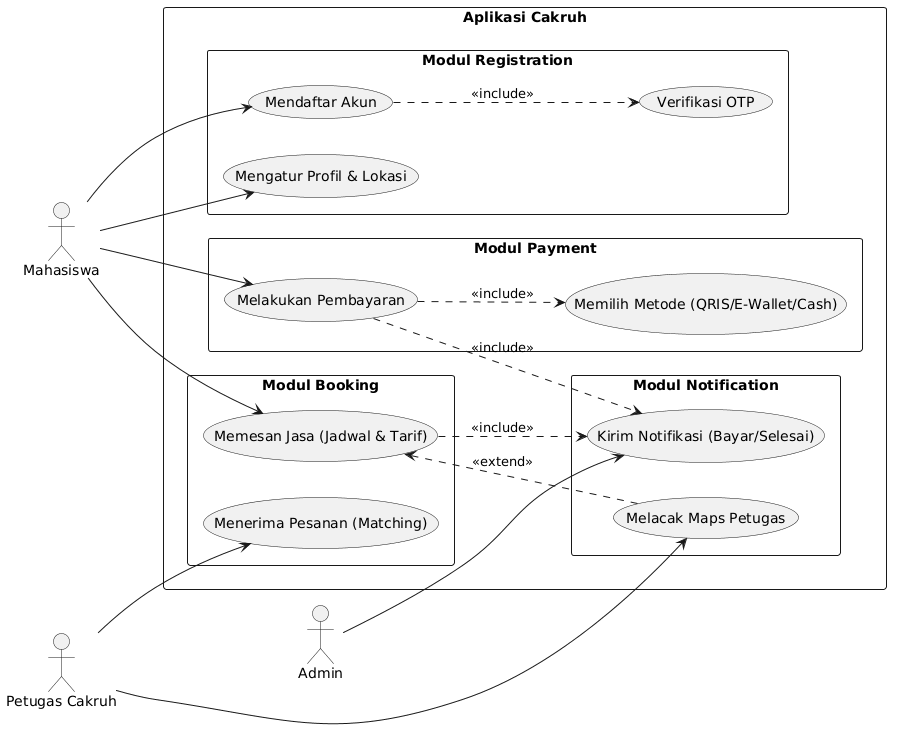
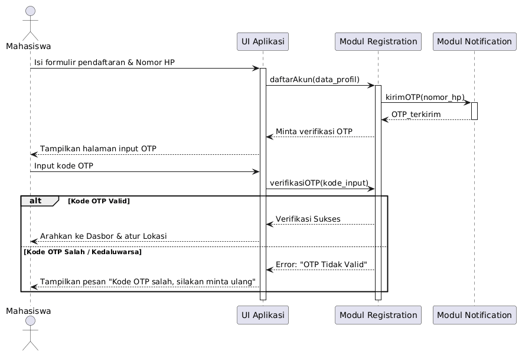
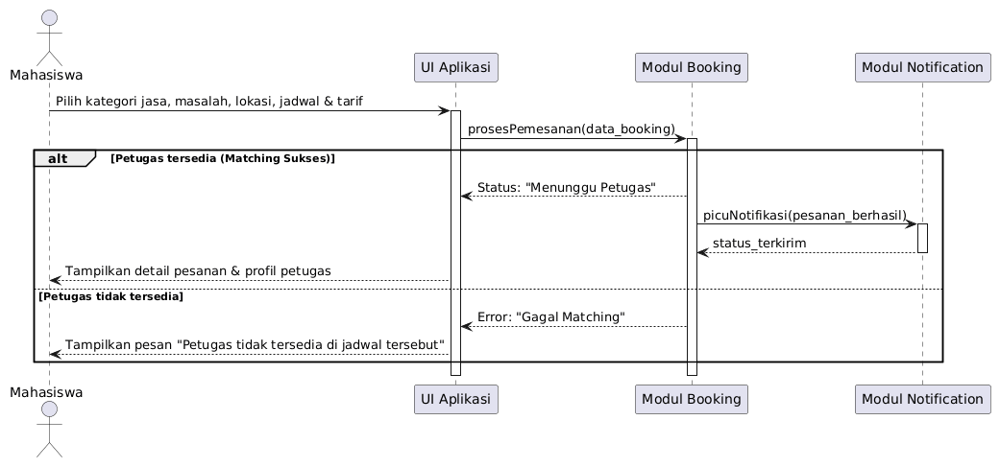

# Diagram Aplikasi Cakruh

### Use Case Diagram

Sistem aplikasi Cakruh dibagi menjadi 4 modul utama: **Registration**, **Booking**, **Payment**, dan **Notification**. Terdapat tiga aktor utama (Mahasiswa, Petugas Cakruh, dan Admin) dengan relasi include dan extend.

### Sequence Diagrams

Terdapat 3 skenario utama yang terjadi di dalam aplikasi Cakruh. Setiap diagram memuat alur pesan antar dan skenario alternatif.

### Skenario 1: Pendaftaran Akun Mahasiswa Baru

Proses registrasi dengan verifikasi OTP

### Skenario 2: Mahasiswa Memesan Jasa

Ini merupakan fitur inti dari aplikasi Cakruh di mana mahasiswa berinteraksi langsung untuk menentukan detail masalah, tarif, dan melakukan matching dengan petugas yang tersedia.

### Skenario 3: Mahasiswa Melakukan Pembayaran

Proses transaksi dari jasa dan menangani kasus pembayaran sukses maupun gagal.

